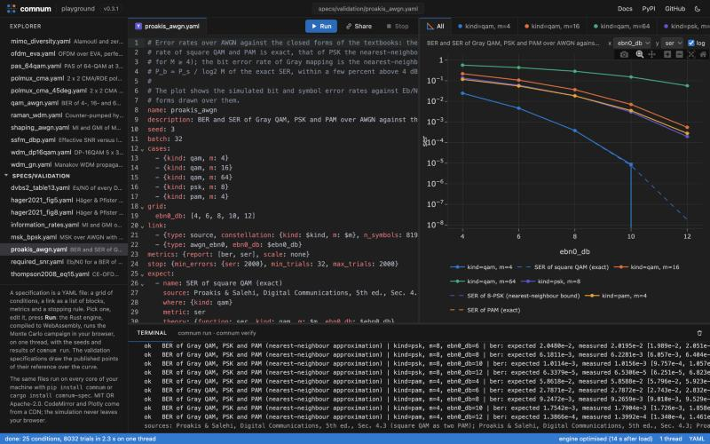

<picture>
  <source media="(prefers-color-scheme: dark)" srcset="https://raw.githubusercontent.com/com-rs/comnum/main/docs/python/_static/readme/logo_dark.png">
  
</picture>

[](https://github.com/com-rs/comnum/actions/workflows/ci.yml)
[](https://crates.io/crates/comnum)
[](https://com-rs.github.io/comnum/)
[](https://com-rs.github.io/comnum/playground/)
[](https://docs.rs/comnum)
[](https://pypi.org/project/comnum/)
[](https://github.com/com-rs/comnum#licence)

Link-level simulation of digital communication systems, wireless and optical, in Rust
with Python bindings: the blocks of a link, a parallel Monte Carlo runner whose results
do not depend on the thread count, and campaigns written as files and checked against
the literature.

<!-- highlights:start -->
<!-- highlights: generated by tools/highlights.py, do not edit -->
- **Lightweight**: one run-time dependency in Python (numpy), 9 direct crates in Rust and no C, C++ or Fortran library to build; 27 MB installed with its dependencies (the benchmark's environment: komm 22 MB, OptiCommPy 321 MB, Sionna 1004 MB).
- **Fast**: compiled Rust, Monte Carlo runs on every core; on one CPU thread, the links of the benchmark take 2.1 to 33 times as long with komm, 2.3 to 4.7 times as long with OptiCommPy and 1.1 to 7.4 times as long with Sionna as with comnum.
- **Safe**: `unsafe` code forbidden in every crate, invalid inputs are errors (one error type), results independent of the thread count; 809 unit tests, 215 validation tests, 291 Python tests.
- **Validated**: compared with 148 papers, standards and reference tools (90 fully reproduced, 54 partly), 484 inconsistencies found in them; 124 validation cards rerun a comparison without the paper.

The numbers are recomputed by `tools/highlights.py` from the recorded benchmark and the validation files; the details are on the page [Why comnum](https://com-rs.github.io/comnum/why.html).
<!-- highlights:end -->

## Try it in the browser

[](https://com-rs.github.io/comnum/playground/)

The [playground](https://com-rs.github.io/comnum/playground/) is the Rust engine compiled to WebAssembly: pick a
campaign (the tutorials, the examples, the validation specifications with their
published points), edit it, run it, read the curves and the signals along the chain.
A point computed in the page is the point of `comnum run`, to the last bit, and nothing
leaves the browser.

## Install

```bash
pip install "comnum[plot]"    # Python 3.11 or later, NumPy only (plus matplotlib for the plots)
cargo add comnum              # the Rust library (Rust 1.85 or later)
cargo install comnum-spec     # the `comnum` command, which runs campaigns written as YAML files
```

## A first result

The bit error rate of 16-QAM over AWGN at 10 dB, simulated and in closed form:

```python
import comnum

rng = comnum.Rng(1)                                   # every result is reproducible from its seed
c = comnum.Constellation("qam", 16).normalized()
bits = comnum.bits(4 * 100_000, rng)
y = comnum.awgn_ebn0(c.map_bits(bits), 10.0, 4, rng)  # Eb/N0 = 10 dB, 4 bits per symbol
print(comnum.ber(c.demap_bits(y), bits), comnum.theory_ber(16, 10.0, "qam"))
```

Next: [getting started](https://com-rs.github.io/comnum/getting_started.html), the
[tutorials](https://com-rs.github.io/comnum/auto_tutorials/index.html), the
[user guide](https://com-rs.github.io/comnum/user_guide/index.html) and a
[gallery](https://com-rs.github.io/comnum/auto_examples/index.html) of classical results, each compared with its
theory or with a named figure of the literature.

## Three examples

**A coded link, on every core.** An LDPC code with 16-QAM over AWGN, run by the
parallel runner until 100 block errors at each $E_b/N_0$, with confidence intervals.
The campaign is a YAML file, run from Python, from the command line
(`comnum run specs/bicm_ldpc.yaml`), in Rust or in the playground.

```python
res = comnum.run_spec("specs/bicm_ldpc.yaml")
res.plot("ebn0_db", "coded_ber", theory=lambda x: comnum.theory_ber(16, x, "qam"))
```


**An optical link.** 16-QAM at 32 GBd over 10 × 80 km of standard fibre with EDFAs,
propagated by the split-step Fourier method, received with dispersion compensation or
digital back-propagation.

```python
res = comnum.run_spec("specs/ssfm_dbp.yaml")
res.plot("power_dbm", "snr_db", by="receiver")
```


**A measured signal.** One second of an LTE carrier recorded by a HackRF One goes
through the same blocks as a simulation: brought to baseband, searched for a cell, the
master information block of its 100 frames decoded.

```python
x, fs, meta = comnum.read_sigmf("capture", channel=0)
y = comnum.select_channel(x, fs, 770.5e6 - 775e6, 1.92e6, 0.6e6)   # the six central resource blocks
cell = comnum.lte_cell_search(y, max_cfo_hz=25e3)[0]
frames = comnum.lte_decode_mib(y, cell)                             # {"sfn", "ports", "n_rb", ...} per frame
```


## What it covers

| Domain | Blocks |
|---|---|
| Mapping and coding | QAM, PSK, PAM, Gray labels, exact and max-log LLRs; CRC, convolutional, turbo, Reed–Solomon, BCH, LDPC and polar codes (with those of 5G NR); probabilistic shaping; closed-form error rates, capacities and finite-length bounds |
| Waveforms | OFDM, constant-envelope OFDM, CPM (MSK, GMSK), LoRa, FBMC/OQAM, UFMC, OTFS; PAPR and its reduction |
| MIMO | ZF, MMSE, SIC, ML, sphere, K-best and message-passing detectors, space-time codes, precoding, capacity, massive MIMO |
| Wireless channels | AWGN, flat and correlated fading, the delay lines of ITU-R M.1225 and 3GPP TR 38.901, delay–Doppler channels, path loss, reconfigurable surfaces |
| Optical | fibre (linear, split-step Fourier, Manakov with PMD) and back-propagation, EDFA and Raman amplification, the GN and EGN models, lasers, modulators, photodiodes, coherent front ends, optical wireless |
| Hardware and DSP | power amplifiers and predistortion, phase noise, frequency and clock offsets, IQ imbalance, DAC and ADC; pulse shaping, resampling, carrier and clock recovery, equalisers, blind estimation |
| Standards | DVB-S, DVB-S2, DVB-T, CCSDS 131.0-B, the 5G NR PDSCH with HARQ, the LTE cell search and MIB, FM broadcasting and RDS |
| Simulation | the parallel Monte Carlo runner (Wilson intervals, stopping rules, operating-point search), declarative campaigns, verification against expected results, SigMF recordings |

Fourteen crates in five layers whose dependencies point downward only
([`docs/ARCHITECTURE.md`](https://github.com/com-rs/comnum/blob/main/docs/ARCHITECTURE.md)); a project can add its own
blocks ([ADR 0006](https://github.com/com-rs/comnum/blob/main/docs/adr/0006-external-blocks.md)).

## Validated, not only tested

Every block enters the library with the reference it is checked against: a closed
form, a table of a standard, a published figure, or the recorded output of a reference
implementation (OptiCommPy, GNPy, Optilux, AFF3CT, Sionna, py3gpp). The comparisons
are written as data, the [validation cards](https://com-rs.github.io/comnum/validation.html), rerun without the
paper, with the inconsistencies found in the documents themselves
([`docs/LITERATURE.md`](https://github.com/com-rs/comnum/blob/main/docs/LITERATURE.md)). Every module has a grade, **A** an
external reference, **B** a closed form only, **C** self-consistency only
([`docs/MATURITY.md`](https://github.com/com-rs/comnum/blob/main/docs/MATURITY.md)).

<!-- generated by tools/maturity_table.py from validation/maturity.yaml: do not edit -->

Summary: 76 modules: 70 at A, 4 at B, 2 at C.

<!-- end of the generated table -->

## About

comnum aims to be a reference link-level simulator: fast, reproducible bit for bit,
validated block by block. It complements Sionna (differentiable, GPU learning), the
MATLAB toolboxes and AFF3CT (wider or more specialised) and GNU Radio (real time):
[comparisons](https://com-rs.github.io/comnum/comparisons.html), [benchmarks](https://com-rs.github.io/comnum/benchmarks.html). In scope: the
physical layer of a point-to-point link, sample by sample. Out of scope: system and
network level, training neural receivers, real-time and hardware targets. The blocks
follow the layout of [OptiCommPy](https://github.com/edsonportosilva/OptiCommPy)
(GPL-3.0, a test oracle only, never imported); the algorithms are written from their
publications.

comnum is developed with an AI coding assistant, and says so plainly: Claude
(Anthropic), through Claude Code, wrote most of the code, tests and documentation,
under the direction of the author, who decided the scope and the architecture, the
models, the references each block is checked against and the tolerances, and reviewed
every change. Correctness rests on the evidence above, not on who wrote a line; the
rules apply to every contribution, human or generated
([`CLAUDE.md`](https://github.com/com-rs/comnum/blob/main/CLAUDE.md), [`CONTRIBUTING.md`](https://github.com/com-rs/comnum/blob/main/CONTRIBUTING.md)). A
disagreement with a reference is a bug: please
[report it](https://github.com/com-rs/comnum/issues/new/choose).

The crates follow semantic versioning with one version for all; the Python API changes
only with a migration note in the [changelog](https://github.com/com-rs/comnum/blob/main/CHANGELOG.md).

## Licence

MIT or Apache-2.0, at your option ([`LICENSE-MIT`](https://github.com/com-rs/comnum/blob/main/LICENSE-MIT),
[`LICENSE-APACHE`](https://github.com/com-rs/comnum/blob/main/LICENSE-APACHE)); third-party data and the recorded oracle
fixtures are listed in [`THIRD_PARTY.md`](https://github.com/com-rs/comnum/blob/main/THIRD_PARTY.md). To cite comnum, use
[`CITATION.cff`](https://github.com/com-rs/comnum/blob/main/CITATION.cff).
