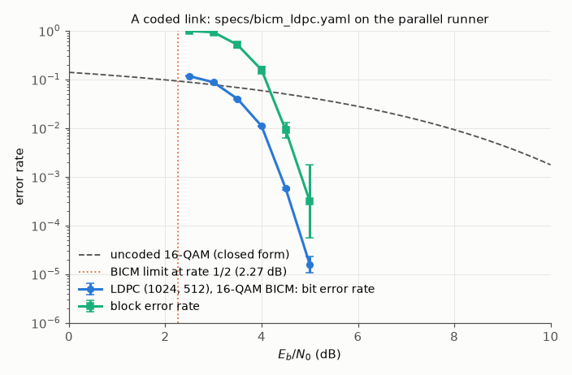
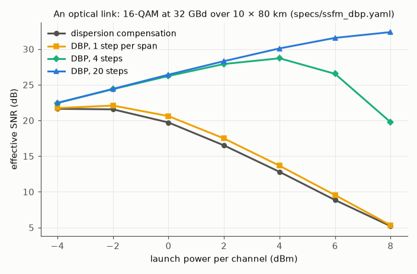
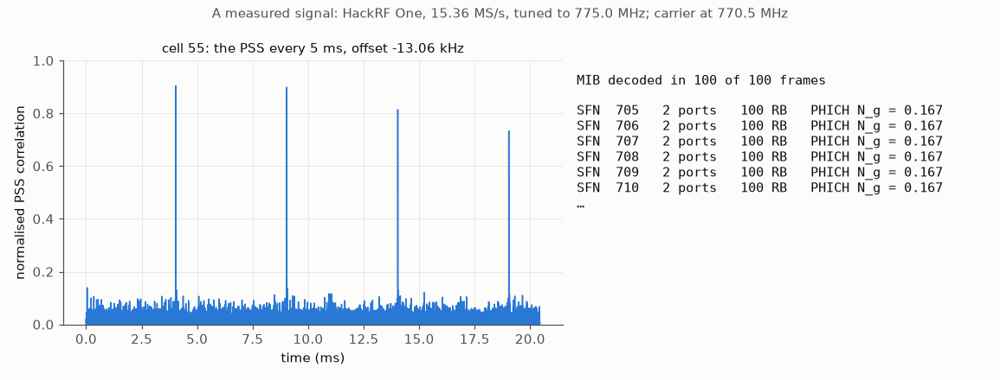

# comnum

[](https://github.com/com-rs/comnum/actions/workflows/ci.yml)
[](https://crates.io/crates/comnum)
[](https://com-rs.github.io/comnum/)
[](https://docs.rs/comnum)
[](https://pypi.org/project/comnum/)
[](https://github.com/com-rs/comnum#licence)

Link-level simulation of digital communication systems, wireless and optical, in Rust
with Python bindings: the blocks of a link, a parallel Monte Carlo runner whose results
do not depend on the thread count, and campaigns written as files and checked against
the literature.

<!-- highlights:start -->
<!-- highlights: generated by tools/highlights.py, do not edit -->
- **Lightweight**: one run-time dependency in Python (numpy), 9 direct crates in Rust and no C, C++ or Fortran library to build; 27 MB installed with its dependencies (the benchmark's environment: komm 22 MB, OptiCommPy 321 MB, Sionna 1004 MB).
- **Fast**: compiled Rust, Monte Carlo runs on every core; on one CPU thread, the links of the benchmark take 2.1 to 33 times as long with komm, 2.3 to 4.7 times as long with OptiCommPy and 1.1 to 7.4 times as long with Sionna as with comnum.
- **Safe**: `unsafe` code forbidden in every crate, invalid inputs are errors (one error type), results independent of the thread count; 749 unit tests, 198 validation tests, 272 Python tests.
- **Validated**: compared with 139 papers, standards and reference tools (88 fully reproduced, 47 partly), 120 inconsistencies found in them; 104 validation cards rerun a comparison without the paper.

The numbers are recomputed by `tools/highlights.py` from the recorded benchmark and the validation files; the details are on the page [Why comnum](https://com-rs.github.io/comnum/why.html).
<!-- highlights:end -->

## Install

```bash
pip install comnum            # Python 3.11 or later; wheels for Linux, macOS and Windows
pip install "comnum[plot]"    # with matplotlib, for the plots
cargo add comnum              # the Rust library (Rust 1.85 or later)
cargo install comnum-spec     # the `comnum` command, which runs campaigns written as YAML files
```

The Python package needs NumPy only. From a clone, `maturin develop --release` builds
it ([getting started](https://com-rs.github.io/comnum/getting_started.html)).

## Three examples

### A coded link, on every core

The bit and block error rates of an LDPC code with 16-QAM over AWGN, run by the
parallel runner until 100 block errors are counted at each $E_b/N_0$, with their
confidence intervals, against the uncoded closed form and the BICM limit of the code
rate:

```python
import comnum
res = comnum.run_spec("specs/bicm_ldpc.yaml")           # the link, the grid and the stopping rule
res.plot("ebn0_db", "coded_ber", theory=lambda x: comnum.theory_ber(16, x, "qam"))
```



The same campaign from the command line, `comnum run specs/bicm_ldpc.yaml`, or in Rust
on the same runner (`comnum::sim`, the example `ber_awgn`). The specification is a
YAML file: the link as a list of blocks, the grid, the metrics and the stopping rule.

```yaml
link:
  - {type: fec_encode, code: &code {type: ldpc, n: 1024, k: 512, seed: 1}, blocks: 8, interleave: true}
  - {type: map, constellation: 16-QAM}
  - {type: awgn_ebn0, ebn0_db: $ebn0_db}
  - demap
  - {type: fec_decode, code: *code, interleave: true}
metrics: {report: [ber, coded_ber, bler]}
stop: {min_errors: {bler: 100}, min_trials: 8, max_trials: 400}
```

### An optical link

16-QAM at 32 GBd over 10 × 80 km of standard fibre with EDFAs, propagated by the
split-step Fourier method, then received with dispersion compensation or digital
back-propagation (`specs/ssfm_dbp.yaml`; the Rust example `ssfm_dbp` writes the same
link by hand):

```python
res = comnum.run_spec("specs/ssfm_dbp.yaml")
res.plot("power_dbm", "snr_db", by="receiver")
```



### A measured signal

A capture of a software radio goes through the same blocks as a simulation. Here one
second of an LTE carrier recorded by a HackRF One (band 28, 15.36 MS/s) is brought to
baseband, searched for a cell, and the master information block of every frame is
decoded:

```python
x, fs, meta = comnum.read_sigmf("capture", channel=0)
y = comnum.select_channel(x, fs, 770.5e6 - 775e6, 1.92e6, 0.6e6)   # the six central resource blocks
cell = comnum.lte_cell_search(y, max_cfo_hz=25e3)[0]
frames = comnum.lte_decode_mib(y, cell)                             # {"sfn", "ports", "n_rb", ...} per frame
```



The receiver finds the cell identity, the frequency offset of the receiver (−13.06 kHz,
the oscillator of the HackRF 17 ppm off) and decodes the MIB of 100 frames of 100,
whose frame numbers follow one another. The Rust example `lte_mib` does the same from
a SigMF file; the FM stereo multiplex and its RDS are received the same way
(`fm_stereo_decode`, `rds_receive`).

## What it covers

Every block is placed in one of fourteen crates, in five layers whose dependencies
point downward only, re-exported by the facade `comnum` and bound to Python by name
(`comnum::channel::awgn`, `comnum.awgn`); the layout and the rules are in
[`docs/ARCHITECTURE.md`](https://github.com/com-rs/comnum/blob/main/docs/ARCHITECTURE.md).

| Domain | Blocks |
|---|---|
| Mapping and coding | QAM, PSK, PAM and custom constellations with Gray labels, exact and max-log LLRs; CRC, scramblers, interleavers, convolutional (Viterbi, BCJR, tail biting), turbo, Reed–Solomon, BCH, LDPC and polar codes, the LDPC and polar codes of 5G NR with their rate matching; probabilistic amplitude shaping; closed-form error rates, capacities and finite-length bounds |
| Waveforms | OFDM (resource grids, pilots, LS and LMMSE estimation, synchronisation), constant-envelope OFDM, CPM (MSK, GMSK), chirp spread spectrum (LoRa), FBMC/OQAM, UFMC, OTFS; PAPR and its reduction |
| MIMO | detectors (ZF, MMSE, SIC, ML, sphere, K-best, message passing), space-time block codes, precoding and capacity, massive MIMO, channel estimation |
| Wireless channels | AWGN, flat and correlated fading, the tapped and clustered delay lines of ITU-R M.1225 and 3GPP TR 38.901, delay–Doppler channels, path loss, reconfigurable surfaces |
| Optical | fibre (linear, split-step Fourier, Manakov with PMD) and back-propagation, EDFA and Raman amplification, the GN and EGN models, lasers, modulators, photodiodes and coherent front ends, indoor optical wireless and free-space optics |
| Hardware | power amplifiers and digital predistortion, phase noise, frequency and clock offsets, IQ imbalance, DAC and ADC |
| Receiver DSP | pulse shaping and filters, rational resampling and the front end of a capture, carrier and clock recovery, adaptive equalisers, dispersion compensation, blind estimation (modulation, SNR, symbol rate) |
| Metrics | error rates, SNR, EVM, mutual and generalised mutual information, the rates of a receiver's posterior, PSD, ACLR, PAPR |
| Standards | DVB-S, DVB-S2, DVB-T, CCSDS 131.0-B, the 5G NR PDSCH with HARQ, the LTE cell search and MIB, FM broadcasting and RDS |
| Simulation | the parallel Monte Carlo runner (Wilson intervals, stopping rules, operating-point search), declarative campaigns, verification against expected results, SigMF recordings |

The declarative blocks are listed by `comnum blocks` with their parameters; a project
can add its own without comnum depending on it
([ADR 0006](https://github.com/com-rs/comnum/blob/main/docs/adr/0006-external-blocks.md)).

## Validated, not only tested

Every block enters the library with the reference it is checked against: a closed
form, a table of a standard reproduced verbatim, a published figure (cited with its
authors, venue, year and figure number), or the recorded output of a reference
implementation (OptiCommPy, GNPy, AFF3CT, Sionna, py3gpp) used as a test oracle. The
comparisons are written as data, the
[validation cards](https://com-rs.github.io/comnum/validation.html), and rerun
without the paper; the inconsistencies found in the documents themselves are
recorded with them
([`docs/LITERATURE.md`](https://github.com/com-rs/comnum/blob/main/docs/LITERATURE.md)).
The strongest evidence of every module: **A**, an external reference; **B**, a closed
form only; **C**, self-consistency only
([`docs/MATURITY.md`](https://github.com/com-rs/comnum/blob/main/docs/MATURITY.md)
gives the tests behind every grade and the regimes not covered).

<!-- generated by tools/maturity_table.py from validation/maturity.yaml: do not edit -->

Summary: 75 modules: 70 at A, 3 at B, 2 at C.

**Foundations**

| Module | Level | Strongest evidence |
|---|---|---|
| Constellations, mapping, demapping and closed-form error rates | A | OptiCommPy outputs; closed forms of Proakis & Salehi |
| Capacity and cutoff rate of CM and BICM | A | Caire, Taricco & Biglieri 1998 Figs. 4–7 |
| Adaptive MQAM over fading | A | Goldsmith & Chua 1997 Figs. 3, 5, 10, Table II |
| Sources (bits, PRBS, uniform and shaped symbols) | A | ITU-T O.150 Sec. 5 and Table 1, exact |
| Differential PSK | A | Pawula, Rice & Roberts 1982 Sec. IV-A; closed forms of Proakis & Salehi |
| Error rates with an imperfect channel estimate and over Jakes' fading | A | Chang & Su 2002 eqs. 31–53, Figs. 3–4 |

**Coding and shaping**

| Module | Level | Strongest evidence |
|---|---|---|
| Convolutional codes (Viterbi, BCJR) | A | AFF3CT; Yasuda et al. Table I |
| Puncturing | A | Yasuda et al. Table I; patterns of IEEE 802.11 and EN 300 421 |
| Turbo codes (LTE) | A | AFF3CT, K = 40 and 1024 |
| LDPC codes | A | AFF3CT, PEG and DVB-S2 short code; Hu et al. 2005 |
| Density evolution of LDPC ensembles | A | Richardson & Urbanke 2001 Tables I-II |
| EXIT charts of parallel concatenated codes | A | ten Brink 2001 Tables II and IV |
| Polar codes (SC, CA-SCL) | A | AFF3CT, SC and CA-SCL |
| 5G NR channel codes: LDPC and polar with rate matching | A | Sionna vectors bit for bit; TS 38.212 tables |
| Reed–Solomon codes | A | AFF3CT; Lin & Costello; ETSI EN 300 744, CCSDS 131.0-B |
| BCH codes | A | AFF3CT; generators of EN 302 307-1 Table 6a |
| CRC | A | CRC polynomials of TS 38.212 |
| Scrambling, interleaving | C | balanced sequences, invertible permutations |
| Finite-length bounds | A | Polyanskiy, Poor & Verdú 2010 Table I; the Shannon limits of BPSK; Costello & Forney 2007 |
| Distribution matching and probabilistic amplitude shaping | A | Schulte & Böcherer 2016 Fig. 2; Böcherer et al. 2015 Tables VI–X |

**Waveforms**

| Module | Level | Strongest evidence |
|---|---|---|
| OFDM, channel estimation and gain correction | A | Cimini 1985 Figs. 3–7; Coleri et al. 2002 Sec. VI-B (with an oversampled comb) |
| OFDM synchronisation (Schmidl–Cox, Moose, van de Beek) | A | Schmidl & Cox 1997, Moose 1994, van de Beek et al. 1997 |
| PAPR: distribution and reduction | A | Ochiai & Imai 2001 eqs. (11), (27); Saul 2004 Figs. 8-9 (recursive clipping) |
| Constant-envelope OFDM | A | Thompson et al. 2008 eq. (15); Guerreiro et al. 2016 Fig. 1; López Morales et al. 2022 Fig. 3; Pacheco & Hatzinakos 2006 Fig. 1 |
| Chirp spread spectrum (LoRa modulation) | A | Chiani & Elzanaty 2019 Table I; Afisiadis et al. 2020 Figs. 2, 7; Vangelista 2017 Fig. 1 |
| Continuous-phase modulation | A | Murota & Hirade 1981 Table I and Fig. 5; Sundberg 1986 Fig. 5; MSK of Proakis & Salehi |
| FBMC/OQAM | A | Bouhadda et al. 2014 Table 1, Figs. 7, 10, 11; Nissel & Rupp 2017 eq. (17); Nissel, Schwarz & Rupp 2017 eqs. (13), (17), Figs. 5-8 |
| UFMC | A | Vakilian et al. 2013 Fig. 3(b) |
| OTFS and the delay–Doppler channel | A | Raviteja et al. 2019 Theorem 1 and its example; Hadani et al. 2017 Fig. 5 qualitatively |

**MIMO**

| Module | Level | Strongest evidence |
|---|---|---|
| MIMO detection | A | Yang & Hanzo 2015 Table X; MRC closed forms |
| Message-passing detection of large MIMO (LAMA, OAMP) | A | Jeon et al. 2018 Table II; Ma & Ping 2017 eq. (42), Figs. 2–3 |
| Space-time block codes | B | Tarokh et al. 1999 eqs. (39)–(40); MRC closed forms |
| Capacity and precoding | A | Telatar 1999 Theorem 2, eqs. (13), (16)–(18), Figs. 1–4 |
| MIMO channel estimation | A | Biguesh & Gershman 2006 Figs. 1–4, eqs. (12)–(59) |
| Multi-user massive MIMO | A | Ngo, Larsson & Marzetta 2013 Props. 1–3, 5–7, Figs. 1 and 4 |
| Downlink NOMA | A | Ding et al. 2014 Fig. 3 table, Fig. 1(a) |

**Wireless channels**

| Module | Level | Strongest evidence |
|---|---|---|
| Path loss (TR 38.901) | A | TR 38.901 Tables 7.4.1-1 and 7.4.2-1 against Sionna 2.2.0 |
| AWGN | B | closed forms of the error rates |
| Flat fading and antenna correlation | A | Loyka 2001 (exponential correlation, Fig. 1); BPSK over Rayleigh fading; MRC |
| Tapped and clustered delay lines (TDL, CDL) | A | ITU-R M.1225 and 3GPP TR 38.901 tables, verbatim |
| Reconfigurable intelligent surface | A | Basar et al. 2019 eqs. (14)–(18), Figs. 6–7 |

**Optical**

| Module | Level | Strongest evidence |
|---|---|---|
| Fibre: linear, split-step Fourier, Manakov, back-propagation | A | OptiCommPy outputs; Häger & Pfister 2021 Figs. 5 and 8; Ip & Kahn 2008 Fig. 12 (in part) |
| GN and EGN models | A | Carena et al. 2014 Fig. 1(a); GNPy outputs; Semrau, Killey & Bayvel 2019 Figs. 4a, 4b, 5 |
| Raman amplification and ISRS | A | Bromage 2004 eqs. (3)–(5), Figs. 7–8; Hu et al. 2004 eq. (2); GNPy outputs; Semrau & Bayvel 2018 eq. (10) |
| EDFA and PMD | A | the Maxwellian DGD of Foschini & Poole 1991 Fig. 3; the accumulated ASE |
| Optical front ends (laser, modulators, photodiodes, coherent receiver) | A | OptiCommPy outputs |
| Indoor optical wireless | A | Barry et al. 1993 Table II; Komine & Nakagawa 2004 Figs. 3–9 |
| Free-space optics | A | Al-Habash et al. 2001 Figs. 3, 6–8 |

**Hardware impairments**

| Module | Level | Strongest evidence |
|---|---|---|
| Nonlinear amplifier driven by OFDM | A | Banelli & Cacopardi 2000 eqs. 7–31, Fig. 5; Bouhadda et al. 2014, Tables 2–3 |
| Power amplifiers, IQ imbalance and digital predistortion | A | Ding et al. 2004 Fig. 4 (memory-polynomial predistortion) |
| Phase noise, frequency and clock offsets | A | IEEE Std 1139-2022 Table B.2 (Allan variances of white FM) |
| DAC and ADC | A | Max 1960 Table II; Bennett 1948; the exact error of a Gaussian input; IEEE Std 1241; Walden 1999 |

**Receiver DSP**

| Module | Level | Strongest evidence |
|---|---|---|
| Filters and resampling | A | OptiCommPy outputs |
| Carrier recovery | A | OptiCommPy outputs; Rife & Boorstyn 1974; Fatadin et al. 2009; Pfau et al. 2009 |
| Clock recovery | A | OptiCommPy outputs |
| Frame synchronisation | A | Massey 1972 Tables I–II (optimum rule) |
| Adaptive equalisers | A | OptiCommPy outputs; Kikuchi's singularity |
| Chromatic dispersion compensation | A | Eghbali et al. 2014 Table I, Figs. 5 and 9 |
| Blind estimation: modulation recognition, M2M4 SNR, symbol rate | A | Pauluzzi & Beaulieu 2000 Figs. 9–10 (M2M4, CRB); exact cumulants of the alphabets |

**Metrics and analysis**

| Module | Level | Strongest evidence |
|---|---|---|
| Error rates, SNR and EVM | A | OptiCommPy outputs |
| Information rates and shaping gains | A | Böcherer et al. 2015 Tables I, III; OptiCommPy outputs |
| Receiver posteriors (`air` metrics) | A | Alvarado et al. 2018 Remarks 4–5, eq. (35) |
| Spectral metrics (PSD, ACLR, PAPR, CCDF) | C | a tone lands in its bin |

**Systems and standards**

| Module | Level | Strongest evidence |
|---|---|---|
| DVB-S | A | EN 300 421 Tables 2 and 3, Figures 2, 4 and 5 |
| DVB-S2 | A | EN 302 307-1 Table 13 and the tables of the standard |
| DVB-T | A | EN 300 744 Tables C.1 and A.1 (Gaussian within 0.12 dB) |
| CCSDS 131.0-B-5 channel coding | A | Tables F-1, 3-1, 6-2, 7-1, 7-5, C-1 and Annex G, exact |
| AIS | A | the CRC catalogue; pyais outputs; a simulated ship end to end |
| FM broadcasting and RDS | A | BS.450 and NRSC-4 tables; a simulated station end to end |
| LTE cell search and MIB | A | TS 36.211 Table 6.11.2.1-1 verbatim; a measured cell decoded |
| 5G NR numerology, SSB, cell search and PDSCH DMRS | A | py3gpp outputs; Lin et al. 2019 |
| 5G NR PDSCH | A | Sionna and py3gpp bit for bit; TS 38.101-4 test 1-2 (2 and 4 RX) within the requirements |

**Simulation and specifications**

| Module | Level | Strongest evidence |
|---|---|---|
| Monte Carlo runner | A | Brown, Cai & DasGupta 2001: the intervals and their exact coverage; thread independence, stopping rules |
| Specifications, verification and operating-point search | B | the search against the inverted closed forms |
| Recordings (SigMF, raw IQ, NPY) | A | sigmf-python, the reference implementation, both ways |

<!-- end of the generated table -->

## Positioning

comnum aims to be a reference link-level simulator: fast, reproducible bit for bit
(seeded streams independent of the thread count), and validated block by block. It
complements the existing tools rather than replacing them: Sionna targets
differentiable, GPU-accelerated end-to-end learning; the MATLAB toolboxes and AFF3CT
cover wider or more specialised ground; GNU Radio streams in real time. comnum offers
one documented chain from the waveform to the metrics, wireless and optical, whose
results trace to a closed form, a standard or a published curve
([comparisons](https://com-rs.github.io/comnum/comparisons.html),
[benchmarks](https://com-rs.github.io/comnum/benchmarks.html)).

In scope: the physical layer of a point-to-point link, simulated sample by sample.
Out of scope, because other tools do it well: system and network level, training
neural receivers (comnum evaluates trained blocks at scale, from their parameters),
real-time and hardware targets, graphical tools, and models without a reference.

The blocks follow the layout, names and conventions of
[OptiCommPy](https://github.com/edsonportosilva/OptiCommPy); the algorithms are
written from their publications. OptiCommPy (GPL-3.0) is a test oracle only, never
imported: the tests read its recorded outputs.

## Stability

Version 0.2.0 is the first public release. From it on, the crates follow semantic
versioning with one version for all, the Python API changes only with a migration note
in the [changelog](https://github.com/com-rs/comnum/blob/main/CHANGELOG.md), CI
checks every pull request with `cargo-semver-checks`, and the schema of the
specifications is versioned. Until then the API moves freely, without deprecated
aliases.

## How this library was written

comnum is developed with an AI coding assistant, and says so plainly: Claude
(Anthropic), through Claude Code, wrote most of the code, tests and documentation,
under the direction of the author, who decided the scope and the architecture, the
models, the references each block is checked against and the tolerances, and reviewed
every change. Correctness rests on the evidence above, not on who wrote a line; the
rules apply to every contribution, human or generated
([`docs/ARCHITECTURE.md`](https://github.com/com-rs/comnum/blob/main/docs/ARCHITECTURE.md),
[`CLAUDE.md`](https://github.com/com-rs/comnum/blob/main/CLAUDE.md)).

## Documentation

- The Python package: [tutorials](https://com-rs.github.io/comnum/auto_tutorials/index.html),
  the [user guide](https://com-rs.github.io/comnum/user_guide/index.html), a
  [gallery](https://com-rs.github.io/comnum/auto_examples/index.html) of classical
  results and of reproduced figures of the literature, the
  [API reference](https://com-rs.github.io/comnum/api/index.html).
- The Rust crates: <https://docs.rs/comnum>; the runnable examples in
  [`examples/`](https://github.com/com-rs/comnum/tree/main/examples); the
  specifications in [`specs/`](https://github.com/com-rs/comnum/tree/main/specs).
- Contributing: [`CONTRIBUTING.md`](https://github.com/com-rs/comnum/blob/main/CONTRIBUTING.md)
  (how a block is validated, the test suites, good first contributions). A
  disagreement with a reference is a bug: please
  [report it](https://github.com/com-rs/comnum/issues/new/choose).

## Licence

MIT or Apache-2.0, at your option
([`LICENSE-MIT`](https://github.com/com-rs/comnum/blob/main/LICENSE-MIT),
[`LICENSE-APACHE`](https://github.com/com-rs/comnum/blob/main/LICENSE-APACHE)). The
data of third parties shipped in the crates and the status of the recorded oracle
fixtures are listed in
[`THIRD_PARTY.md`](https://github.com/com-rs/comnum/blob/main/THIRD_PARTY.md). To cite
comnum, use [`CITATION.cff`](https://github.com/com-rs/comnum/blob/main/CITATION.cff).
