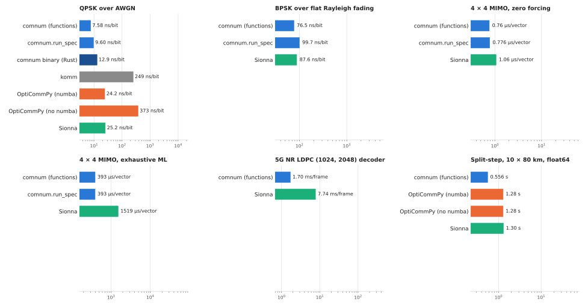
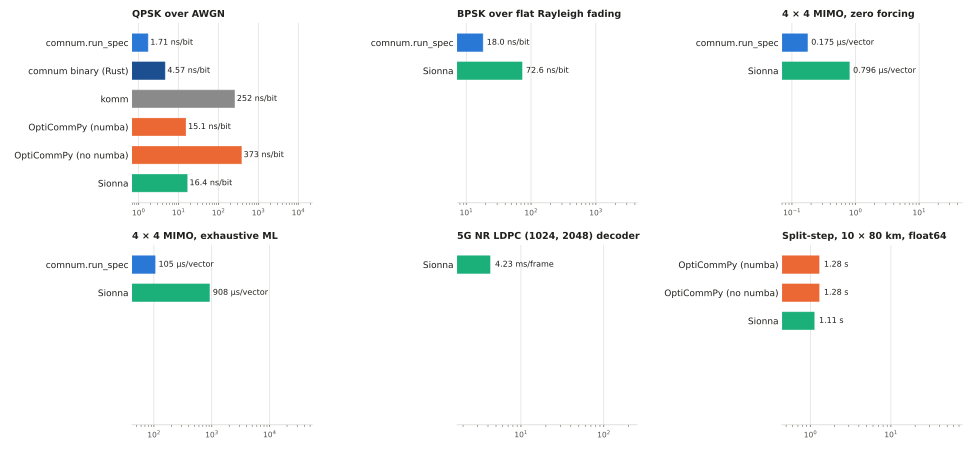
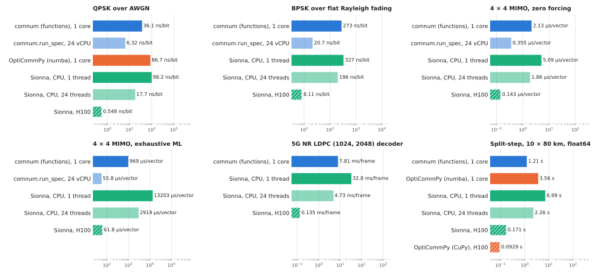
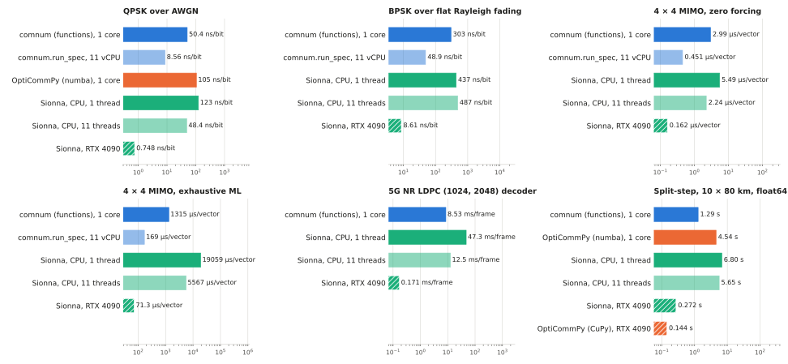

Benchmarks against other libraries
==================================

The same links simulated with comnum and with the Python libraries that offer them,
`komm <https://github.com/rwnobrega/komm>`_, `OptiCommPy
<https://github.com/edsonportosilva/OptiCommPy>`_ (with and without numba) and `Sionna
<https://github.com/NVlabs/sionna>`_, with the same parameters and the same number of
samples: do the results agree, and how long does each library take? This page is the
overview; :doc:`every number <benchmarks_details>` (each point with its confidence
interval, the closed form, the first-call times, the versions and the command of every
run) is on the detail page, and the :doc:`comparisons <comparisons>` page compares
single blocks value by value.

How to read it: every time is the median of five runs of the same work, per unit of
work (bit, vector, frame or propagation), after a warm-up call; *1 thread* means every
thread pool at one thread, *all cores* the defaults of the library (every core the
process may use); the results of every library agree with the closed form, or with
comnum when there is none, on every machine (the detail page shows the intervals).
comnum computes in float64, Sionna in float32 by default (float64 for the split-step
below), OptiCommPy in float64 except its Gray constellations: the faster library is
not always doing less work. komm and OptiCommPy without numba ran on the laptop only.

.. generated by tools/benchmarks_page.py from benchmarks/libraries/results/: do not edit

The machines
------------

.. list-table::
   :header-rows: 1
   :widths: 18 52 30

   * - Machine
     - What it is
     - What ran on it
   * - laptop
     - Apple M6, 12 cores, 24.0 GB, macOS 27.0
     - every library; the reference of the CPU comparison
   * - RunPod pod, H100 SXM
     - Intel Xeon Platinum 8480+, 24 vCPU; a `RunPod <https://www.runpod.io/>`_ Secure Cloud pod with one NVIDIA H100 SXM (80 GB HBM3), the PyTorch template (torch 2.13, CUDA 13.0): a container with a CPU quota on a shared host
     - comnum, OptiCommPy and Sionna on the CPU; Sionna and OptiCommPy's split-step on the GPU
   * - RunPod pod, RTX 4090
     - AMD EPYC 7K62 48-Core, 11 vCPU; a `RunPod <https://www.runpod.io/>`_ Secure Cloud pod with one NVIDIA GeForce RTX 4090 (24 GB), the PyTorch template (torch 2.13, CUDA 13.0): a container with a CPU quota on a shared host
     - comnum, OptiCommPy and Sionna on the CPU; Sionna and OptiCommPy's split-step on the GPU

The laptop ran a native build of comnum from the checkout; the pods installed ``comnum`` from PyPI, the other libraries from PyPI at the versions of ``requirements.txt`` and ``requirements-gpu.txt``, and ran ``benchmarks/libraries/runpod.sh``. The commit, the versions and the full machine information of every run are on the :doc:`detail page <benchmarks_details>`.

On the CPU
----------

**Same work, one thread.** The time per unit of work of every library on one thread of the laptop, six headline cases (the detail page has every case and every machine). Lower is better; the axis is logarithmic.

   One thread of the laptop: ns per bit, µs per vector (4 × 4 16-QAM), ms per frame, s per propagation; median of five runs.

**Every core.** The same cases with the thread pools at their defaults: comnum is then its Monte Carlo runner (``comnum.run_spec``, the trials in parallel; its functions are single-threaded and are left out), Sionna its PyTorch pools, OptiCommPy its numba threads, komm NumPy.

   Every core of the laptop: the same units; median of five runs.

**Does the ranking hold on other processors?** The 1-thread time of each library over that of the comnum functions on the same machine (× 2 means twice the time of comnum), on the laptop and on the CPU of the two pods. The ratios compare libraries on one machine; the machines are not compared with each other here (their cores differ: see the GPU section).

.. list-table::
   :header-rows: 1

   * - Case
     - Library
     - laptop
     - RunPod pod, H100 SXM
     - RunPod pod, RTX 4090
   * - QPSK over AWGN
     - komm
     - × 32.9
     - —
     - —
   * - QPSK over AWGN
     - OptiCommPy (numba)
     - × 3.19
     - × 2.40
     - × 2.09
   * - QPSK over AWGN
     - Sionna
     - × 3.33
     - × 2.72
     - × 2.44
   * - BPSK over flat Rayleigh fading
     - Sionna
     - × 1.15
     - × 1.20
     - × 1.44
   * - 4 × 4 MIMO, zero forcing
     - Sionna
     - × 1.40
     - × 2.40
     - × 1.84
   * - 4 × 4 MIMO, exhaustive ML
     - Sionna
     - × 3.87
     - × 13.6
     - × 14.5
   * - 5G NR LDPC (1024, 2048) decoder
     - Sionna
     - × 4.54
     - × 4.20
     - × 5.55
   * - Split-step, 10 × 80 km, float64
     - OptiCommPy (numba)
     - × 2.31
     - × 2.95
     - × 3.52
   * - Split-step, 10 × 80 km, float64
     - Sionna
     - × 2.34
     - × 5.79
     - × 5.28

What the numbers do not say: OptiCommPy's first call compiles its numba kernels (about 3 s), Sionna's first call initialises PyTorch; the single-thread path of comnum over flat fading was rewritten after the first run of this benchmark found it slower than Sionna (same error counts, see the detail page).

What a GPU changes
------------------

Sionna is designed for GPUs, and OptiCommPy has a CuPy copy of its split-step. On each pod the same scripts ran every library on the pod's CPU (one thread, then every vCPU of the quota) and Sionna and the split-step of OptiCommPy on the pod's GPU, with the input copied to the device and the result brought back inside the timed call. comnum has no GPU path: the comparison is a library on the device against comnum on the CPU of the same machine, which is what a user choosing between the two faces.

**RunPod pod, H100 SXM** (Intel Xeon Platinum 8480+, 24 vCPU, NVIDIA H100 80GB HBM3).

   RunPod pod, H100 SXM: comnum on the CPU, Sionna on the CPU and on the H100, OptiCommPy on the CPU and, for the split-step, on the GPU (hatched); median of five runs.

.. list-table::
   :header-rows: 1

   * - Case
     - comnum, 1 core
     - comnum.run_spec, 24 vCPU
     - Sionna, CPU, 24 threads
     - Sionna, H100
     - OptiCommPy, H100
     - GPU gain over comnum, 1 core
     - GPU gain over comnum, 24 vCPU
   * - QPSK over AWGN
     - 36.1 ns/bit
     - 6.32 ns/bit
     - 17.7 ns/bit
     - 0.548 ns/bit
     - —
     - × 65.8
     - × 11.5
   * - BPSK over flat Rayleigh fading
     - 273 ns/bit
     - 20.7 ns/bit
     - 196 ns/bit
     - 8.11 ns/bit
     - —
     - × 33.7
     - × 2.55
   * - 4 × 4 MIMO, zero forcing
     - 2.13 µs/vector
     - 0.355 µs/vector
     - 1.86 µs/vector
     - 0.143 µs/vector
     - —
     - × 14.9
     - × 2.49
   * - 4 × 4 MIMO, exhaustive ML
     - 969 µs/vector
     - 55.8 µs/vector
     - 2919 µs/vector
     - 61.8 µs/vector
     - —
     - × 15.7
     - × 0.903
   * - 5G NR LDPC (1024, 2048) decoder
     - 7.81 ms/frame
     - —
     - 4.73 ms/frame
     - 0.135 ms/frame
     - —
     - × 58.0
     - —
   * - Split-step, 10 × 80 km, float64
     - 1.21 s
     - —
     - 2.26 s
     - 0.171 s
     - 0.0929 s
     - × 7.06
     - —

**RunPod pod, RTX 4090** (AMD EPYC 7K62 48-Core, 11 vCPU, NVIDIA GeForce RTX 4090).

   RunPod pod, RTX 4090: comnum on the CPU, Sionna on the CPU and on the RTX 4090, OptiCommPy on the CPU and, for the split-step, on the GPU (hatched); median of five runs.

.. list-table::
   :header-rows: 1

   * - Case
     - comnum, 1 core
     - comnum.run_spec, 11 vCPU
     - Sionna, CPU, 11 threads
     - Sionna, RTX 4090
     - OptiCommPy, RTX 4090
     - GPU gain over comnum, 1 core
     - GPU gain over comnum, 11 vCPU
   * - QPSK over AWGN
     - 50.4 ns/bit
     - 8.56 ns/bit
     - 48.4 ns/bit
     - 0.748 ns/bit
     - —
     - × 67.4
     - × 11.4
   * - BPSK over flat Rayleigh fading
     - 303 ns/bit
     - 48.9 ns/bit
     - 487 ns/bit
     - 8.61 ns/bit
     - —
     - × 35.1
     - × 5.67
   * - 4 × 4 MIMO, zero forcing
     - 2.99 µs/vector
     - 0.451 µs/vector
     - 2.24 µs/vector
     - 0.162 µs/vector
     - —
     - × 18.5
     - × 2.79
   * - 4 × 4 MIMO, exhaustive ML
     - 1315 µs/vector
     - 169 µs/vector
     - 5567 µs/vector
     - 71.3 µs/vector
     - —
     - × 18.4
     - × 2.37
   * - 5G NR LDPC (1024, 2048) decoder
     - 8.53 ms/frame
     - —
     - 12.5 ms/frame
     - 0.171 ms/frame
     - —
     - × 50.0
     - —
   * - Split-step, 10 × 80 km, float64
     - 1.29 s
     - —
     - 5.65 s
     - 0.272 s
     - 0.144 s
     - × 4.74
     - —

What this says: on the chains that vectorise (the AWGN and fading links, the LDPC decoder, the split-step), the GPU is 5 to 70 times faster than comnum on one core, and 2 to 12 times faster than comnum's runner on every vCPU of the pod. On the exhaustive ML detector, a search over 65 536 candidates per vector that does not vectorise, comnum's runner on the 24 vCPU of the H100 pod is level with Sionna's reference detector on the H100 (56 against 62 µs per vector), and within a factor 2.4 on the RTX 4090 pod. The two cards give nearly the same times: at these sizes the GPU is not the bottleneck, the host and the Python overhead of each call are. On one core, the pods are 2 to 7 times slower than the laptop for comnum and 4 to 13 times for Sionna (see the limits below).

Limits
------

- **Cases chosen by comnum.** The scenarios are classical links that several libraries
  offer; other cases, sizes and batch shapes may rank the libraries differently, and
  Sionna's home ground (large batches, learning, automatic differentiation) is not
  measured here. The scripts are published to be rerun.
- **Small work for a GPU.** 10⁶ bits, 2000 frames or 2¹⁴ symbols per call do not fill
  an RTX 4090, let alone an H100: the two cards give nearly the same times, and a
  larger batch would lower the GPU times further. What the GPU columns show is the
  cost of a call of that size, which is what a Monte Carlo loop pays.
- **Containers.** The pods are containers with a CPU quota on a shared host: the pools
  of the mode *all cores* are sized to the quota, but the host's other tenants can
  slow a run; the laptop's times were taken on a quiet machine.
- **One wheel for every x86-64.** On the pods comnum ran from the PyPI wheel, compiled
  for the baseline x86-64 instruction set (no AVX2); the laptop ran a native build.
  Part of the per-core gap between the pods and the laptop may come from that, not
  from the processors alone.
- **Not timed here.** Specialised C++ decoders (AFF3CT) are timed against comnum's,
  one thread, on the :doc:`comparisons <comparisons>` page.

Reproducing
-----------

See the :doc:`detail page <benchmarks_details>`: the commands, the environment files and ``benchmarks/libraries/runpod.sh`` for a GPU machine.

.. toctree::
   :hidden:

   benchmarks_details
